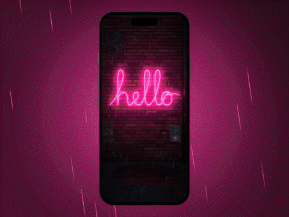

# Neon Sign

Draw your own neon sign on a rainy alley wall. Write or doodle with your finger; when you lift it, the stroke freezes
into a glass tube. Flip the wall switch and the tubes flicker a few times before they come fully on, throwing coloured
light across every brick, the mortar joints and the puddle at your feet. Tap a tube and pick a colour, and the new gas
flows along the tube from the electrode to the far end.

<p align="center">
  <a href="docs/demo.mp4"></a>
  <br>
  <a href="docs/demo.mp4"><b>▶ Watch the full demo with sound (MP4, 16 s)</b></a>
</p>

Built with **Expo · React Native · [react-native-skia](https://shopify.github.io/react-native-skia/) (Graphite) ·
Reanimated 4 · Blender**.

## How it works

- **Blender renders the wall once, not the lighting.** `blender/scripts/build_scene.py` builds the alley in code (~590
  irregular bricks with bevels and chipped edges, recessed mortar, damp streaks, torn posters, a drainpipe, a
  transformer box, wet concrete with a puddle). `render_passes.py` bakes it into layers: ambient, albedo,
  camera-space normals, and a data map (roughness / AO / reflectivity).
- **The app lights it in real time.** A Skia runtime shader (`app/src/shaders/wall.ts`) computes N·L from the normal
  map with the light direction taken from the gradient of the neon glow, adds wet specular streaks, and renders the
  puddle reflection with ripples and raindrop splashes. The glow of every tube segment is baked into a small light
  atlas (`app/src/neon/atlas.ts`, 3 segments per RGB tile) and only re-rendered when the strokes change; each frame
  just multiplies it by per-segment brightness and colour.
- **Reanimated drives everything from one clock**: ignition flicker, gas flowing during a recolour, the power cut and
  relight, rain, sparks and gyro parallax (two-finger drag on the simulator). No per-frame allocation: shared arrays
  and uniform objects are edited in place.
- **Sound** is synthesized with numpy (`blender/scripts/synth_audio.py`, `app_music.py`): switch clunks, ignition
  crackles, gas flow, and a soft lo-fi background loop.

## Run it

```bash
cd app
npm install
npx expo run:ios            # a dev build — Skia 3 doesn't run in Expo Go
```

Draw anywhere on the wall; lifting your finger turns the stroke into a tube. Tap the switch on the right of the wall
(it blinks until you first use it) to turn the power on or off. Tap a tube, then a colour, to recolour it; the bottom
bar picks the colour and thickness of the next stroke, with Undo / Clear. On a device, tilt the phone to slide the
glass highlights and shadows; on the simulator, drag with two fingers.

Re-render the wall (optional, needs Blender; tested with 5.2):

```bash
PREVIEW=1 tools/build.sh    # quick preview (~20 s)
tools/build.sh              # final quality
```

## Project layout

```
app/src/scene/NeonScene.tsx   canvas, layers, draw / select gestures, switch, clock, tilt, demo mode
app/src/shaders/wall.ts       wall + ground lighting, wet gloss, puddle reflection
app/src/shaders/post.ts       neon-tinted steam, air glow, vignette, film grain
app/src/scene/rain.ts         rain, visible only where neon or street light hits it
app/src/neon/                 stroke → tube model, tube rendering, flicker, light atlas, clips / electrodes / cables,
                              sparks, drips, chase pulses, touch ripples
app/src/ui/                   wall switch, colour bar, pop-up palette
app/src/intro/                the app-open animation
app/src/demo/script.ts        the scripted showcase used for the demo video (EXPO_PUBLIC_DEMO=1)
app/src/fx/                   audio (expo-audio) and haptics
blender/scripts/              scene build, render passes, sprites, audio / music synthesis, promo video builder
tools/                        build, simulator recording, promo and contact-sheet helpers
notes/                        development notes (performance, polish rounds)
```

## Recording the demo video

`EXPO_PUBLIC_DEMO=1` makes the app play a scripted storyboard (`app/src/demo/script.ts`): a virtual finger draws a
heart and a star, recolours "hello", cuts the power under a lightning flash, relights the sign, draws an underline and
ends on a finale. `tools/showcase.sh` records it on the simulator in slow motion and retimes it to 60 fps,
`blender/scripts/mix_showcase.py` scores it to the recording, and `tools/promo.sh` builds the 4:3 phone-mockup clip
with an end card. See `notes/m4.md` for the exact commands.

## License

[MIT](LICENSE) © Hoa Hoang ([@novahoangdev](https://x.com/novahoangdev))
